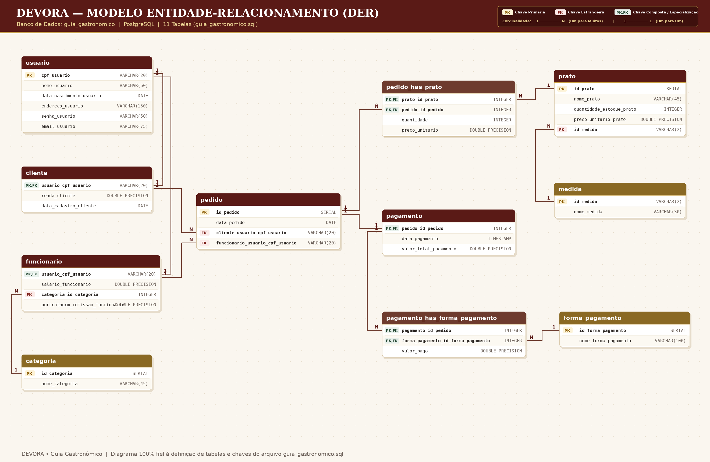

# 🍽️ DEVORA — Guia Gastronômico & Pedidos Online

<p align="center">
  <strong>Sistema web completo para gestão gastronômica, cardápio digital e pedidos online com controle de estoque.</strong>
</p>

---

## 📚 Identificação do Projeto

- **Projeto:** DEVORA — Guia Gastronômico
- **Disciplina:** Desenvolvimento Web 1 (DW1) — 4º Bimestre
- **Ano:** 2026
- **Aluna:** Maria Eduarda Rodrigues Ferreira
- **Turma:** M32
- **Repositório:** `MariaEduardaRodrigues_4bim_Devora`

---

## 📖 Sobre o Projeto

O **DEVORA** é uma aplicação web funcional desenvolvida para a disciplina de **Desenvolvimento Web 1 (DW1)**, estruturada na arquitetura **Cliente/Servidor**, seguindo o padrão **MVC (Model-View-Controller)** e integrada ao banco de dados relacional **PostgreSQL**.

O sistema divide-se em duas experiências integradas:
1. **Visão do Cliente (Loja e Pedidos):** vitrine pública para explorar o cardápio, filtrar por categorias, adicionar pratos ao carrinho com alertas inteligentes de estoque baixo, criar conta, autenticar-se via cookies e finalizar pedidos com escolha de pagamento e baixa automática no estoque.
2. **Visão Administrativa (Painel Restrito):** dashboard exclusivo para funcionários com resumo quantitativo do sistema e operações CRUD completas de **Pratos** (com upload de imagens), **Categorias**, **Unidades de Medida** e **Usuários** (Clientes e Funcionários).

---

## 🚀 Funcionalidades Principais

### 🛒 Visão do Cliente (`frontend/cliente/`)
- **Cardápio Público:** acesso livre sem necessidade de login, com busca por nome e filtro dinâmico por categorias.
- **Carrinho e Controle de Estoque:** carrinho persistido no navegador (`localStorage`), bloqueio de quantidades acima do estoque disponível e **aviso visual sempre que o prato possuir 3 unidades ou menos** em estoque.
- **Cadastro de Clientes:** validação de CPF (11 dígitos), e-mail único, senha criptografada (`bcrypt`) e validação de **data de nascimento** (bloqueando datas futuras e exigindo idade mínima de **16 anos**).
- **Fechamento e Pagamento (`pagamento.html`):** exige autenticação antes de concluir; carrega automaticamente nome e endereço do cliente, gera **QR Code Pix (BR Code)** com função *Copia e Cola*, valida dados e parcelamento de **Cartão de Crédito/Débito** e oferece pagamento em **Dinheiro**.
- **Baixa Automática no Estoque:** ao confirmar o pedido, o backend executa uma transação SQL (`BEGIN` / `COMMIT`) que registra o pedido, os itens (`pedido_has_prato`), o pagamento (`pagamento` e `pagamento_has_forma_pagamento`) e subtrai a quantidade comprada diretamente do estoque do prato.

### 🔐 Autenticação, Cookies e Recuperação de Senha (`frontend/login/`)
- **Login em Duas Etapas:** validação prévia do e-mail seguida da verificação de senha.
- **Sessão com Cookies:** uso de cookie assinado e `httpOnly` (`usuarioLogado`) gerenciado via `cookie-parser`, com botão de **Sair (Logout)** que encerra a sessão no servidor.
- **Redirecionamento por Perfil:**
  - Apenas **Cliente** → direcionado para a loja (`cliente.html`).
  - Apenas **Funcionário** → direcionado para o painel administrativo (`admin.html`).
  - **Cliente e Funcionário** → exibe tela de escolha para decidir como deseja acessar.
- **Recuperação de Senha:** geração de token temporário com validade de 30 minutos (`recuperacao_senha`), permitindo redefinir e salvar a nova senha na tabela `usuario`.

### 🛠️ Visão Administrativa (`frontend/admin/`, `prato/`, `categoria/`, `medida/`, `usuario/`)
- **Dashboard Administrativo (`admin.html`):** protegido por middleware (`verificaFuncionarioPagina`), exibe contadores em tempo real de pratos, categorias, medidas e usuários.
- **Pratos:** CRUD completo com upload, redimensionamento (`multer` + `sharp`) e exibição de imagens na pasta `imagens/`, além de preço, estoque, categoria e unidade de medida.
- **Categorias:** CRUD completo das categorias gastronômicas (Pizzas, Massas, Hambúrgueres, Risotos, Sobremesas, Bebidas, entre outras).
- **Medidas:** CRUD completo das unidades de medida (`UN`, `KG`, `G`, `L`, `ML`, `CX`, `PC`, `DZ`, `M`, `FD`).
- **Usuários:** CRUD completo com associação 1:1 para **Cliente** (renda e data de cadastro) e/ou **Funcionário** (salário e comissão).

---

## 🏗️ Arquitetura e Padrão MVC

### 🖥️ Frontend — View (`frontend/`)
Construído com **HTML5 semântico** (`<header>`, `<nav>`, `<main>`, `<section>`, `<aside>`, `<footer>`), **CSS3 externo** (identidade visual vinho `#5a1a16` e dourado `#c9a24b`) e **JavaScript** comunicando-se com a API via `fetch`.

### ⚙️ Backend — Routes, Controllers e Middlewares (`backend/`)
- **Routes (`backend/routes/`):** mapeiam os endpoints da aplicação (`loginRoutes.js`, `pedidoRoutes.js`, `pratoRoutes.js`, `categoriaRoutes.js`, `medidaRoutes.js`, `usuarioRoutes.js`, `clienteRoutes.js`, `funcionarioRoutes.js`).
- **Controllers (`backend/controllers/`):** concentram as regras de negócio e consultas SQL (`loginController.js`, `recuperacaoController.js`, `pedidoController.js`, `pratoController.js`, `categoriaController.js`, `medidaController.js`, `usuarioController.js`, `clienteController.js`, `funcionarioController.js`).
- **Middlewares (`backend/middlewares/authMiddleware.js`):** controlam a autenticação e restringem rotas de escrita e páginas administrativas exclusivamente a funcionários logados.

---

## 📂 Estrutura do Projeto

```text
devora/
├── backend/
│   ├── controllers/
│   │   ├── categoriaController.js
│   │   ├── clienteController.js
│   │   ├── funcionarioController.js
│   │   ├── loginController.js
│   │   ├── medidaController.js
│   │   ├── pedidoController.js
│   │   ├── pratoController.js
│   │   ├── recuperacaoController.js
│   │   └── usuarioController.js
│   ├── middlewares/
│   │   └── authMiddleware.js
│   ├── routes/
│   │   ├── categoriaRoutes.js
│   │   ├── clienteRoutes.js
│   │   ├── funcionarioRoutes.js
│   │   ├── loginRoutes.js
│   │   ├── medidaRoutes.js
│   │   ├── pedidoRoutes.js
│   │   ├── pratoRoutes.js
│   │   └── usuarioRoutes.js
│   ├── .env
│   ├── database.js
│   ├── mailer.js
│   └── server.js
│
├── frontend/
│   ├── admin/
│   │   ├── admin.css
│   │   ├── admin.html
│   │   └── admin.js
│   ├── categoria/
│   │   ├── categoria.css
│   │   ├── categoria.html
│   │   └── categoria.js
│   ├── cliente/
│   │   ├── cliente.css
│   │   ├── cliente.html
│   │   ├── cliente.js
│   │   ├── pagamento.css
│   │   ├── pagamento.html
│   │   └── pagamento.js
│   ├── login/
│   │   ├── esqueci.html
│   │   ├── login.css
│   │   ├── login.html
│   │   ├── login.js
│   │   ├── recuperar.js
│   │   └── redefinir.html
│   ├── medida/
│   │   ├── medida.css
│   │   ├── medida.html
│   │   └── medida.js
│   ├── menu/
│   │   ├── menu.css
│   │   ├── menu.html
│   │   └── menu.js
│   ├── prato/
│   │   ├── prato.css
│   │   ├── prato.html
│   │   └── prato.js
│   └── usuario/
│       ├── usuario.css
│       ├── usuario.html
│       └── usuario.js
│
├── imagens/
│   └── (imagens dos pratos e silhueta.jpg)
│
├── .gitignore
├── diagrama.png
├── guia_gastronomico.sql
├── index.html
├── package.json
├── package-lock.json
└── README.md
```

---

## 🗄️ Banco de Dados (PostgreSQL)

- **Banco de dados:** `guia_gastronomico`
- **Script DDL e Carga Inicial:** `guia_gastronomico.sql` (contém `CREATE TABLE`, chaves primárias, chaves estrangeiras, sequences e `INSERT INTO` com carga inicial completa).

### Tabelas do Sistema
- **Entidades principais e independentes:** `usuario`, `categoria`, `medida`, `forma_pagamento`
- **Especializações / dependentes:** `cliente`, `funcionario`, `prato`, `pedido`, `pagamento`, `recuperacao_senha`
- **Tabelas associativas (N:M):** `pedido_has_prato`, `pagamento_has_forma_pagamento`

### Relacionamentos do Modelo (1:1, 1:N e N:M)
- **Relacionamentos 1:1:**
  - `usuario` ↔ `cliente` (um usuário pode possuir um perfil de cliente).
  - `usuario` ↔ `funcionario` (um usuário pode possuir um perfil de funcionário).
  - `pedido` ↔ `pagamento` (cada pedido possui um pagamento associado).
- **Relacionamentos 1:N:**
  - `categoria` → `prato` (uma categoria agrupa vários pratos; cada prato pertence a uma categoria).
  - `medida` → `prato` (uma unidade de medida é utilizada por vários pratos).
  - `cliente` → `pedido` (um cliente pode realizar vários pedidos).
  - `funcionario` → `pedido` (um funcionário pode atender vários pedidos).
- **Relacionamentos N:M (Tabelas Associativas):**
  - `pedido` ↔ `prato` por meio da tabela **`pedido_has_prato`** (um pedido pode conter vários pratos e um prato pode estar presente em vários pedidos, registrando `quantidade` e `preco_unitario`).
  - `pagamento` ↔ `forma_pagamento` por meio da tabela **`pagamento_has_forma_pagamento`** (um pagamento pode ser quitado com uma ou mais formas de pagamento e uma forma de pagamento é usada em vários pagamentos, registrando `valor_pago`).

### Diagrama Entidade-Relacionamento



---

## 💻 Tecnologias Utilizadas

| Tecnologia | Finalidade |
| :--- | :--- |
| **HTML5 & CSS3** | Estrutura semântica e estilização responsiva das interfaces |
| **JavaScript (ES6+)** | Interatividade do frontend, validações, carrinho e consumo de API |
| **Node.js & Express** | Servidor web, rotas REST e middlewares de autenticação |
| **PostgreSQL (`pg`)** | Banco de dados relacional e transações SQL |
| **Cookie-Parser & Bcrypt** | Sessão segura com cookies assinados e hash de senhas |
| **Multer & Sharp** | Upload e processamento de imagens dos pratos |
| **Dotenv & Cors** | Gerenciamento de variáveis de ambiente e requisições |
| **Git & GitHub** | Controle de versão e hospedagem do repositório |

---

## ⚙️ Como Executar o Projeto Localmente

### 1. Clonar o repositório
```bash
git clone [https://github.com/mariaeduarda-rodrigues/MariaEduardaRodrigues_4bim_Devora.git](https://github.com/mariaeduarda-rodrigues/MariaEduardaRodrigues_4bim_Devora.git)
cd MariaEduardaRodrigues_4bim_Devora
```

### 2. Instalar as dependências
```bash
npm install
```

### 3. Configurar o banco de dados PostgreSQL
1. Crie um banco de dados chamado **`guia_gastronomico`** no PostgreSQL (pgAdmin ou terminal `psql`).
2. Execute o script **`guia_gastronomico.sql`** para criar todas as tabelas, relacionamentos e dados iniciais.

### 4. Configurar o arquivo `.env`
Crie um arquivo `.env` dentro da pasta `backend/` com as credenciais do seu PostgreSQL:

```env
DB_HOST=localhost
DB_PORT=5432
DB_USER=postgres
DB_PASSWORD=SUA_SENHA
DB_NAME=guia_gastronomico
PORT=3000
```

### 5. Iniciar o servidor
```bash
node backend/server.js
```

Acesse no navegador: **`http://localhost:3000`**

---

## 📋 Checklist de Requisitos Atendidos

- [x] Aplicação web funcional baseada na arquitetura Cliente/Servidor e padrão MVC
- [x] Node.js com separação em Routes e Controllers
- [x] Conexão com PostgreSQL via variáveis de ambiente (`.env`)
- [x] Modelagem relacional com tabelas independentes, relacionamentos **1:1**, **1:N** e **N:M** (`pedido_has_prato` e `pagamento_has_forma_pagamento`)
- [x] Script `.sql` com DDL (PK/FK) e carga inicial (mínimo de 10 registros por tabela)
- [x] Uso de tags HTML5 semânticas (`<header>`, `<nav>`, `<main>`, `<section>`, `<aside>`, `<footer>`) e CSS externo
- [x] CRUD com cadastro, upload e exibição de imagens
- [x] Sistema de login/logout com uso de cookies e redirecionamento por perfil
- [x] Visão do cliente (cardápio, carrinho, regras de negócio e checkout) e visão administrativa (dashboard e CRUDs)
- [x] `.gitignore` configurando exclusão de `node_modules/` e `.env`
- [x] `README.md` completo com diagrama do banco de dados

---

## 👩‍💻 Autoria

**Maria Eduarda Rodrigues Ferreira**  
Turma **M32** — Desenvolvimento Web 1 (DW1) — **2026**  
*DEVORA — Uma boa experiência começa à mesa.*